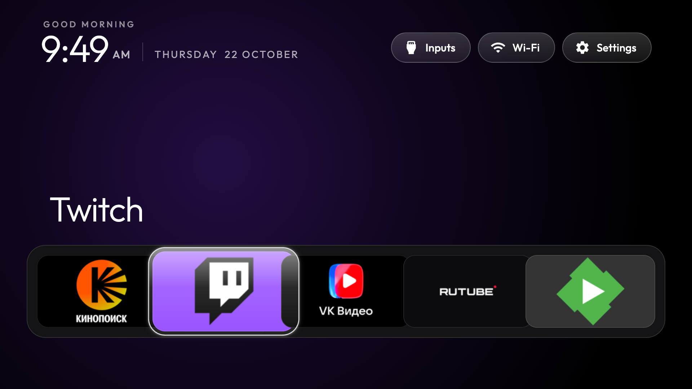
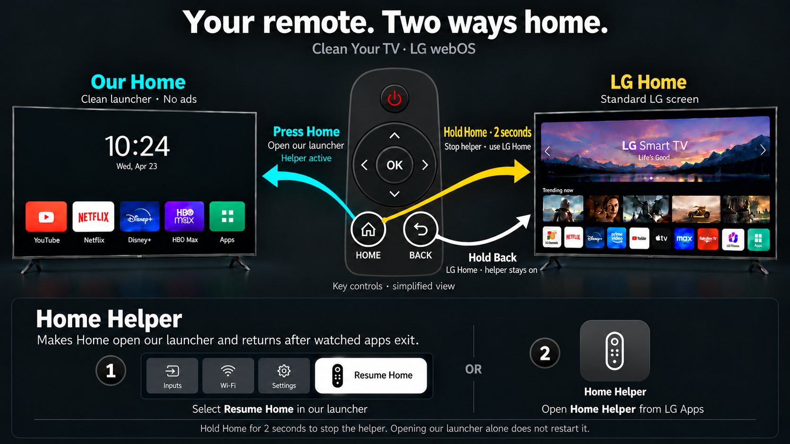

# Clean Your TV — LG webOS

**Your apps. A quieter home screen. A way back.**

A community launcher and optional native Home-button helper for LG webOS TVs.
Based on [webos-vibehack](https://github.com/OmkarK97/webos-vibehack).
**No root. No firmware flashing. No always-on computer, Raspberry Pi or router script.**
The launcher and native helper run on the TV itself on the tested setup.
A computer is needed to build, install and configure them, and later for updates;
it can be switched off during everyday use. No USB drive or external server is required.
LG Developer Mode must remain active. Local network connectivity is still needed
for the helper's paired power/foreground monitoring.

> Tested on **LG OLED55C3RLA (C3), firmware 43.21.71**.
> Other models, remotes and firmware versions are unverified. Not affiliated with LG.

[Install](docs/INSTALL.md) · [Recovery](docs/RECOVERY.md) ·
[Compatibility](docs/COMPATIBILITY.md) · [Build](docs/BUILD.md) · [Update & remove](docs/MAINTENANCE.md)



*Launcher 1.0.11, rendered locally with an example five-app configuration.
Your apps and their order are configured during setup; they are not bundled.*

## What it does

| Feature | Behavior |
| --- | --- |
| Personal home screen | Local app grid, configurable dock, hidden tiles and tile ordering; no sponsored rows in this launcher |
| Short Home | Native on-TV interception returns to the launcher without passing through LG Home on the tested setup |
| Hold Home for 2 seconds | Stops interception and returns to LG Home |
| Resume interception | Select **Resume Home** in Home, or manually open **Home Helper** from LG Apps |
| Wi-Fi shortcut | Opens LG's network setup overlay |
| Automatic startup | Returns after standby and cold boot using input restoration plus a guarded fallback helper; no external device runs the startup logic |
| Exit with Back | Returns after watched apps exit, preserving in-app navigation and exit confirmation; LG Home can briefly flash |
| Quick standby/resume | Avoids relaunching a launcher already restored by webOS, preserving arrows and OK after a fast power cycle |
| Remote controls | Arrows, held arrows, OK, volume and pointer remain usable; wheel events are forwarded |
| Failure recovery | Watchdog cleanup releases interception if the handler stalls; long Home provides a manual escape |
| Local interface | App tiles, font and splash assets are stored locally; the menu does not wait for an Internet download |

This does not remove system advertisements, uninstall apps, or replace the operating
system's Home destination. It provides an alternative screen. Cold boot still has
an initial black interval; early display timing is under investigation.

## How it works

**Home** is the app launcher. **Home Helper** handles the Home button and watches
for exits from configured apps. Both run on the TV. The helper leaves ordinary
in-app Back navigation, exit confirmations and the other remote controls intact.



*Illustrated controls and example screens; button layout varies by remote.*

**Hold Back exits the app; hold Home stops the helper.** When the helper is active,
it returns to our launcher after a watched app exits through LG Home. That path
can briefly show LG Home; it is not the same direct path as short Home.

### Remote control guide

| Button | What it does |
| --- | --- |
| **Arrows / hold an arrow** | Move through tiles and menus; normal navigation inside apps. |
| **OK / pointer click** | Open the selected app or activate a control. |
| **Short Home** | Return directly to our launcher while Home Helper is active. With the helper stopped, LG handles Home normally. |
| **Hold Home ~2 seconds** | Emergency exit: stop the helper and open LG Home. Preferences are kept; this is **not a factory reset**. |
| **Short Back** | Go back inside the current app. Its exit dialog and Cancel action still work normally. On a confirmed exit from a watched app, the helper returns to our launcher. |
| **Hold Back** | Use webOS's exit-to-Home action. It **does not stop the helper**; the exit watcher can then return to our launcher. |
| **Volume + / −, mute** | Normal TV/audio controls. |
| **Move the Magic Remote / wheel** | Pointer and wheel events pass through. Wheel-to-tile selection is not implemented in our launcher. |
| **Power** | Normal TV standby/wake. With startup configured and the helper not stopped, our launcher returns automatically; cold boot still takes time. |
| **Hold 1, if assigned** | Open Home using LG Quick Access. This shortcut must be assigned during setup; it does not resume a stopped helper by itself. |

### Resume after an emergency exit

1. Open **Home** from LG's app list, or use your assigned Quick Access shortcut.
2. Select **Resume Home** in the top action row.
3. The helper starts and the button disappears. Short Home works again.

Opening Home alone does **not** clear the emergency stop. The Resume Home button
uses the system's helper-presence signal: it appears when the helper is disconnected
and stays hidden while it is connected. If that status cannot be read, open
**Home Helper** directly from LG's app list instead. No additional LS2 permission
is required. A single-instance lock prevents duplicate controllers.

The UI above describes the **1.1.0 launcher** with helper **0.6.13**.
Older release packages may call the helper **Native Home Prototype** and lack the
Resume Home button; manually opening that helper performs the same recovery.
The long-Back action is documented by [LG's remote guide](https://webostv.developer.lge.com/develop/guides/magic-remote);
app-specific exit behavior can vary. See [Recovery](docs/RECOVERY.md) for troubleshooting.

## Get started

1. Enable LG Developer Mode and pair the webOS CLI with your TV.
2. Run the app-sync tool to build an inventory for **your** TV.
3. Build your personalized launcher and install the optional helper.
4. Configure the helper, then test long-Home recovery before daily use.

Follow the [installation guide](docs/INSTALL.md). The generic launcher release asset
has an empty inventory: sync and rebuild it before use. The helper asset is ready
to install on compatible ARM32 devices, but still needs local pairing/setup.

## Developer Mode auto-renewal — Beta

Home 1.1.0 adds **Settings → Enable Beta**. It is off by default and aims to renew
the session directly on the TV, without external devices. **Real renewal still
needs validation: keep monitoring your official Developer Mode timer.**
See [setup, status and feedback instructions](docs/DEVELOPER-MODE-BETA.md).

## Tested release

Current release: launcher **1.1.0** + unchanged helper **0.6.13**. The new Beta
service and settings panel are locally tested; integrated real renewal is not
yet validated. The previous launcher **1.0.13** added the tested recovery UI,
app names, icons and hover labels. The native input/watchdog code is unchanged
from helper 0.6.12. Two quick standby/resume cycles passed after
the focus fix, including arrows, OK and short Home. Earlier tests covered volume,
pointer, long-Home recovery and watchdog cleanup. The public build replaces the
original owner's watched-app list with your locally generated configuration;
that packaging/setup path has not yet been tested by a second user.

Developer Mode must remain active. A LAN outage can affect the optional power and
foreground watcher. Wheel input is forwarded, but wheel-to-tile selection is not
implemented. See [known limits](docs/COMPATIBILITY.md).

## Project layout

```text
launcher/          Web launcher and local splash image
native/app/        Home controller, policies and native entry point
native/prototype/  Remote relay/filter source and tests
native/service/    Guarded startup service
scripts/           Build and setup tools
docs/              Installation, recovery and limitations
```

## Credits

Built on the work of [OmkarK97/webos-vibehack](https://github.com/OmkarK97/webos-vibehack)
and [Gathin23/cleanyourtv](https://github.com/Gathin23/cleanyourtv).
MIT-licensed project code; Outfit uses SIL OFL and the bundled ws library uses MIT.
See [LICENSE](LICENSE) and [third-party notices](THIRD_PARTY_NOTICES.md).

No firmware images, extracted proprietary binaries, TV credentials or personal
app inventories are included. Please redact logs before opening an issue.
